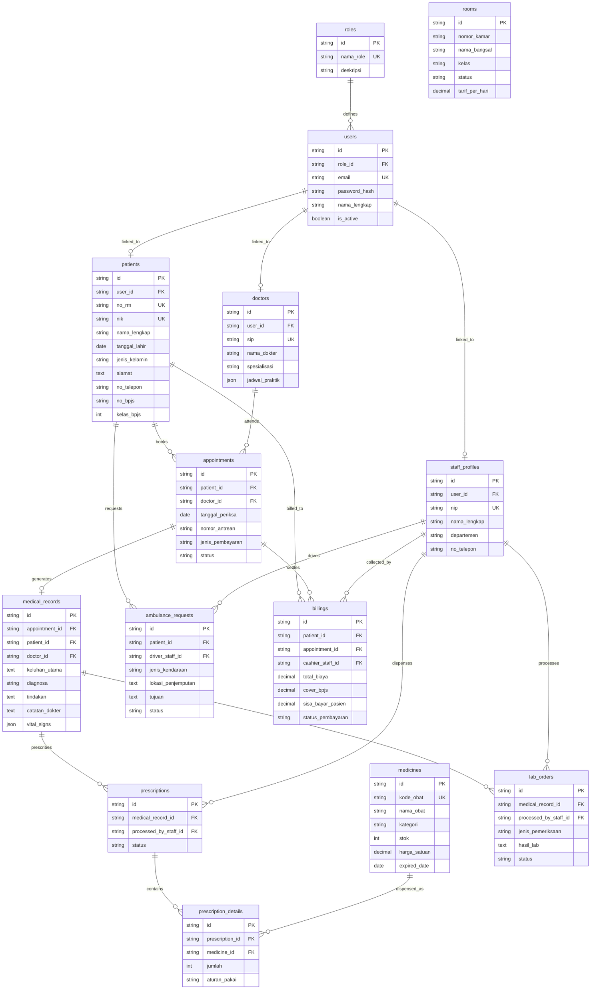

# RS Bhakti Digital — SIMRS Enterprise Monorepo Architecture

Sistem Informasi Manajemen Rumah Sakit (SIMRS) Enterprise Edition terintegrasi berbasis arsitektur monorepo untuk **RS Bhakti Digital**.

---

## 1. Arsitektur Monorepo

```
rs-bhakti-digital-simrs/
├── backend/                       # Node.js / Express & Prisma REST API Engine
│   ├── src/
│   │   ├── server.ts              # Core HTTP & WebSocket Express Server
│   │   ├── controllers/           # REST API Controllers (Auth, Admisi, EMR, Farmasi, Lab, Billing, IGD)
│   │   ├── middlewares/           # JWT Authentication & RBAC Guards
│   │   ├── models/                # TypeScript Interfaces untuk 14 Tabel Entitas
│   │   ├── routes/                # API Routers (/api/v1/...)
│   │   └── database/
│   │       ├── migrations/        # Raw SQL DDL Migrations (PostgreSQL / MySQL)
│   │       ├── schema.prisma      # Prisma ORM Schema dengan Relasi Lengkap
│   │       └── seeders/           # Production-Grade Indonesian Medical Seed Data
│   ├── laravel/                   # Laravel 11 Alternative Mirror (Models, Migrations, Routes)
│   ├── package.json
│   └── tsconfig.json
│
├── src/                           # Frontend Web & Desktop UI (React 19 + Tailwind v4 + Vite)
│   ├── main.tsx                   # React Entrypoint
│   ├── App.tsx                    # Master RBAC Router, Boot Timer & Layout Switcher
│   ├── assets/
│   │   ├── logo.png               # Official RS Bhakti Digital Logo Asset
│   │   └── splash.jpg             # Animated Boot Graphic
│   ├── components/
│   │   ├── layout/                # AppShell, Sidebar, Topbar, SplashScreen
│   │   ├── shared/                # Lucide-Compatible SVG Icons
│   │   └── ui/                    # WCAG 2.1 Buttons, Inputs, Cards, Badges, Modals, Tables
│   ├── contexts/                  # AuthContext dengan Persistensi RBAC & Switch Persona
│   ├── lib/                       # Types, Constants (13 Roles), Mock Data, Tauri Bridge
│   └── pages/                     # 11 Modul SIMRS (Admisi, EMR, Farmasi, Lab, Kasir, IGD, Rawat Inap, dll)
│
├── src-tauri/                     # Tauri Desktop App Engine (Windows .msi/.exe, macOS .dmg, Linux .deb)
│   ├── tauri.conf.json            # Desktop Window Specs, Native Printing, System Tray & Security CSP
│   ├── Cargo.toml                 # Rust Package Manifest
│   └── src/main.rs                # Rust Native Application Entrypoint
│
├── frontend-mobile/               # Flutter Mobile Client (iOS & Android)
│   ├── pubspec.yaml               # Flutter Package Dependencies
│   └── lib/
│       ├── main.dart              # Mobile MaterialApp Entrypoint
│       ├── screens/               # Mobile Splash, Login, Portal Pasien & Portal Nakes
│       └── services/              # API Client Service
│
├── docker-compose.yml             # Local MySQL 8.0, PostgreSQL 16, Redis & Backend Containers
├── flyenv.config.json             # FlyEnv Local Relational Database & Dev Environment Configuration
└── .env.example                   # Full Environment & BPJS/SatuSehat Bridging Template
```

---

## 2. Skema Basis Data Relasional (14 Entitas Inti)



---

## 3. Matriks Hak Akses Peran (RBAC)

| Peran (Role) | Landing Page Default | Modul yang Dapat Diakses |
|---|---|---|
| **Admin SIMRS** (`admin`) | `Overview` | Akses penuh seluruh 11 modul, kepegawaian, database, dan pengaturan |
| **Direktur RS** (`direktur`) | `Overview` | Laporan eksekutif, rekapitulasi finansial, sensus rawat inap, monitoring IGD |
| **Dokter Spesialis / Umum** (`dokter`) | `DoctorDashboard` | Poli rawat jalan, EMR / Rekam Medis (SOAP, ICD-10), order resep & lab |
| **Perawat Medis** (`perawat`) | `Rawat Inap` | Sensus kamar inap, input tanda vital, operan shift, triase IGD |
| **Apoteker / Farmasi** (`apoteker`) | `Farmasi` | Validasi e-resep, dispensing obat, kontrol stok depo, verifikasi kedaluwarsa |
| **Analis Laboratorium** (`analis_lab`) | `Laboratorium` | Daftar order lab, input hasil spesimen, validasi rentang normal/kritis |
| **Radiografer** (`radiografer`) | `Laboratorium` | Permintaan foto rontgen, USG, CT-Scan, dan catatan radiologi |
| **Kasir & Keuangan** (`kasir`) | `Kasir & Billing` | Loket pembayaran, kalkulasi billing terpadu, bridging klaim BPJS, kuitansi |
| **Petugas Admisi** (`admisi`) | `Admisi & Antrian` | Pendaftaran pasien baru/lama, bridging BPJS NIK, penerbitan nomor antrean |
| **Driver Ambulans** (`driver`) | `IGD & Logistik` | Monitoring permintaan ambulans darurat, penugasan armada, dispatch |
| **Petugas CSSD** (`cssd`) | `IGD & Logistik` | Sterilisasi instrumen bedah, update status kamar (`steril_cssd`) |
| **IT Support** (`it_support`) | `Overview` | Pengaturan sistem, diagnostik server, status koneksi database |
| **Pasien** (`pasien`) | `Overview` | Portal mandiri pasien, riwayat periksa, antrean aktif, kuitansi pembayaran |

---

## 4. Panduan Eksekusi & Quickstart

### A. Frontend Web & Desktop Preview
Aplikasi web berjalan di port Vite (default 8443) dengan hot-reload otomatis.
- **Buka Browser/Preview**: `http://localhost:8443`
- **Boot Sequence**: Animasi splash screen 2.8 detik dengan progress bar dan tombol lewati (`ESC`).
- **Demo Quick-Login**: Halaman login menyediakan 1-klik login untuk seluruh 13 peran untuk menguji redirect dinamis dan guard RBAC.

### B. Backend REST API (Node.js / Express)
```bash
cd backend
npm install
npm run dev
# Server aktif di http://localhost:3001
# Healthcheck: http://localhost:3001/health
# API Directory: http://localhost:3001/api
```

### C. Basis Data Relasional (FlyEnv / Docker)
```bash
# Menjalankan MySQL, PostgreSQL, dan Redis via Docker
docker-compose up -d

# Menjalankan migrasi DDL untuk 14 tabel inti
mysql -u simrs_user -p rsbhakti_simrs < backend/src/database/migrations/001_initial_schema.sql
```

### D. Desktop Application (Tauri)
```bash
cargo tauri dev
```

### E. Mobile Application (Flutter)
```bash
cd frontend-mobile
flutter pub get
flutter run
```
